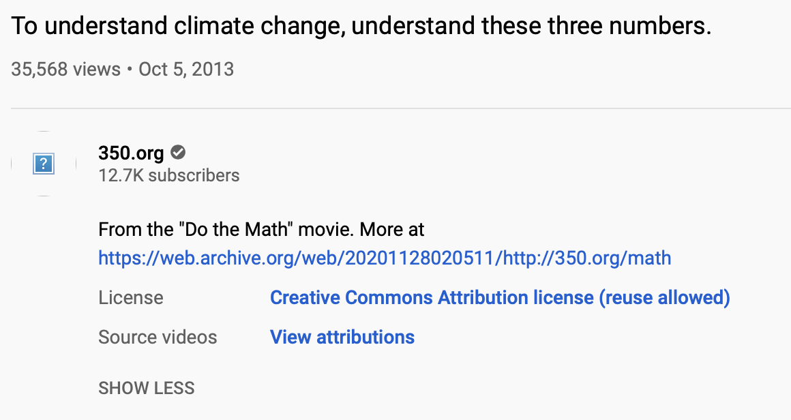

# Dokumentation, Gebrauch und Lizenzen des Videos von 350.org 

## 🎬 Verwendetes Video

- **Titel**: *To understand climate change, understand these three numbers*
- **Kanal**: 350.org
- **YouTube-Link**:  <a href="https://www.youtube.com/watch?v=5KtGg-Lvxso" class="external-link" target="_blank">https://www.youtube.com/watch?v=5KtGg-Lvxso</a> 
- **Veröffentlichungsdatum**: 5. Oktober 2013

## Bereitstellung in der OER „Affektrhetorik in Online-Videos zur Klimakrise“

Das Video wird im Rahmen dieser OER über einen **externen Download-Link (FU-Box)** zur Verfügung gestellt.

🔗 Unter folgendem <a href="https://box.fu-berlin.de/s/LAryL6sa7sEXFEa" class="external-link" target="_blank">Downloadlink</a> kann das Video für den lokalen, privaten Gebrauch heruntergeladen werden.

Die Bereitstellung erfolgt über die Server-Infrastruktur der <a href="https://www.fu-berlin.de/" class="external-link" target="_blank">Freien Universität Berlin</a>, die wir in diesem Fall für die bildungsbezogene Verfügbarmachung der OER-Materialien nutzen.

## Lizenzangabe

Das Video war zum Zeitpunkt der Erstellung der OER auf YouTube mit folgender Lizenz gekennzeichnet:

> Creative Commons Attribution license (reuse allowed)

Diese Formulierung entspricht der Lizenz:
🔗 <a href="https://creativecommons.org/licenses/by/3.0/" class="external-link" target="_blank">Creative Commons Attribution 3.0 Unported (CC BY 3.0)</a>

Damit ist eine Wiederverwendung, Verbreitung, Bearbeitung und auch kommerzielle Nutzung erlaubt – **unter der Bedingung der Namensnennung**.

Die Lizenz wurde nachträglich aus dem Videobeschreibungstext auf YouTube entfernt. 

## Archivnachweis (Wayback Machine)

Die ursprüngliche Lizenzangabe wurde auf dem Portal <a href="https://web.archive.org/" class="external-link" target="_blank">Internet Archive Wayback Machine</a> dokumentiert und archiviert.

Unter folgendem <a href="https://web.archive.org/web/20201128020511/https://www.youtube.com/watch?v=5KtGg-Lvxso" class="external-link" target="_blank">Link</a> ist die archivierte Version ebenfalls verfügbar.

## Rechtliche Bewertung und Kontext der Nutzung

Nach deutschem Urheberrecht und den Creative-Commons-Richtlinien gilt:

> Bereits geschlossene CC-Lizenzverträge lassen sich nicht widerrufen oder aufkündigen. Hat eine Urheberin ihr Werk veröffentlicht und dabei per CC lizenziert (etwa per CC BY-4.0), dann läuft ein nachträglicher Widerruf ins Leere. Mit anderen Worten: Der Lizenzvertrag ist unwiderruflich [^url-oer].

* Die Nutzung im Rahmen dieser OER ist rechtlich abgesichert.
* Das Video wird **nicht verändert** und **korrekt attribuiert**.
* Die Bereitstellung dient ausschließlich **nicht-kommerziellen, bildungsbezogenen Zwecken**.

[^url-oer]: <https://open-educational-resources.de/creative-commons-lizenzen-zuruecknehmen-oder-aendern/>

Das Video wird in der QUADRIGA-OER „Affektrhetorik in Online-Videos zur Klimakrise“ als Untersuchungsgegenstand und kommentiertes Material verwendet, um digitale Filmanalysen exemplarisch durchzuführen. 

## Hinweis

Diese Datei dient der rechtlichen Dokumentation und Nachvollziehbarkeit im Sinne guter wissenschaftlicher Praxis und OER-Transparenz.

